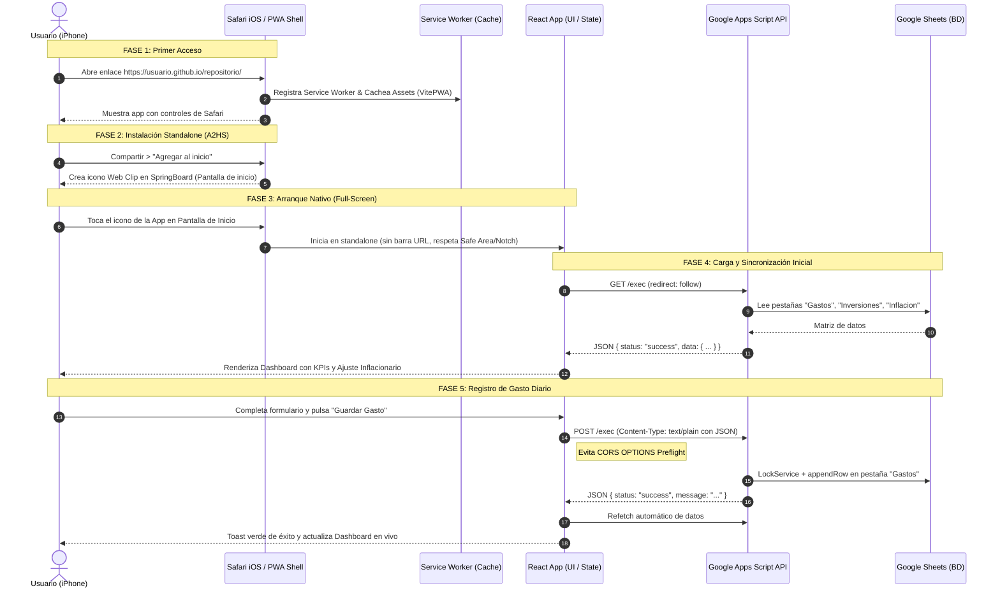

# 📋 Mapa de Contexto & Flujo de Trabajo (Workflow)
## PWA Finanzas Personales & Portfolio (iOS + React + Google Apps Script)

Este documento detalla el ciclo de vida completo de la aplicación desde que el usuario abre el enlace en Safari en un iPhone hasta la sincronización en segundo plano con Google Sheets y el cálculo del rendimiento real ajustado por inflación.

---

## 🗺️ Diagrama General del Flujo



---

## 📱 Fase 1: Primer Acceso desde Safari iOS (Browser Mode)

1. **Petición HTTP y Negociación SSL/TLS**:
   - El usuario abre `https://<usuario>.github.io/<repositorio>/` en Safari.
   - **Requisito crítico**: GitHub Pages provee HTTPS nativo. Sin HTTPS, WebKit en iOS bloquea el Service Worker y deshabilita la capacidad de PWA.

2. **Lectura de Metadatos en `<head>` (`index.html`)**:
   - WebKit analiza las etiquetas exclusivas de Apple:
     - `<meta name="apple-mobile-web-app-capable" content="yes">`: Informa al sistema que esta web puede desacoplarse del navegador.
     - `<meta name="apple-mobile-web-app-status-bar-style" content="black-translucent">`: Configura la barra superior para fusionarse con el tema oscuro.
     - `<meta name="viewport" content="... viewport-fit=cover">`: Le indica a iOS que extienda el viewport detrás del Notch o Dynamic Island.
     - `<link rel="apple-touch-icon" href="...">`: Icono de alta resolución que se usará para el icono en la pantalla de inicio.

3. **Instalación en Segundo Plano del Service Worker**:
   - VitePWA (`workbox`) descarga y almacena en caché local del dispositivo los archivos estáticos (`HTML`, `JS`, `CSS`, fuentes e iconos).
   - La aplicación queda lista para abrir instantáneamente en subsecuentes visitas.

---

## 📲 Fase 2: Instalación Standalone en iOS (Add to Home Screen)

1. El usuario toca el botón **Compartir** de Safari (icono de cuadrado con flecha).
2. Selecciona **"Agregar al inicio"** (*Add to Home Screen*).
3. iOS extrae el nombre desde `<meta name="apple-mobile-web-app-title">` y el icono desde `apple-touch-icon`.
4. El sistema crea un **Web Clip** nativo en la SpringBoard (pantalla de inicio del iPhone).
5. A partir de este momento, **el usuario nunca más necesita abrir Safari para usar la app**.

---

## ⚡ Fase 3: Arranque Nativo (Full-Screen Standalone Mode)

Cuando el usuario pulsa el icono desde la pantalla de inicio:

1. **Aislamiento de Navegador**:
   - iOS abre la aplicación mediante una instancia aislada de WebKit con `display-mode: standalone`.
   - **Sin barra de URL superior**, sin barra de pestañas ni flechas atrás/adelante de Safari.
2. **Gestión de Áreas Seguras (Safe Area Insets)**:
   - El CSS de la app aprovecha `padding-top: env(safe-area-inset-top)` para que el encabezado no quede tapado por la Dynamic Island o el Notch del iPhone.
   - El CSS aplica `padding-bottom: env(safe-area-inset-bottom)` para que la barra de navegación inferior quede por encima de la barra de gestos de inicio de iOS.
3. **Prevención de Zoom Molesto**:
   - Todos los inputs tienen `font-size: 16px` mínimo y `user-scalable=no` para evitar que Safari haga zoom automático desagradable al hacer foco en un campo.

---

## 🔄 Fase 4: Sincronización Inicial de Datos (React -> Google Apps Script)

1. **Montaje de React y Hook `useSheets()`**:
   - Al cargar el componente principal, se activa el hook `useSheets()`.
   - Estado inicial: `loading: true`, `error: null`.
2. **Petición GET**:
   - Llama a `fetch(VITE_SHEETS_API_URL, { method: 'GET', redirect: 'follow' })`.
3. **Manejo de Redirección Google (HTTP 302)**:
   - Apps Script siempre redirige la llamada desde `script.google.com/macros/s/.../exec` hacia un subdominio temporal `script.googleusercontent.com/...`.
   - La directiva `redirect: 'follow'` asegura que el navegador siga la redirección automáticamente con las cabeceras intactas.
4. **Respuesta y Procesamiento**:
   - Apps Script lee las tres pestañas en paralelo bajo un candado `LockService` para garantizar consistencia.
   - Retorna:
     ```json
     {
       "status": "success",
       "data": {
         "gastos": [...],
         "inversiones": [...],
         "inflacion": [...]
       }
     }
     ```
   - React guarda los arrays en estado y conmuta a `loading: false`. La barra superior muestra la píldora verde *"Sheets Online"*.

---

## 📊 Fase 5: Motor de Cálculo Financiero y Métricas

El componente `Dashboard.jsx` procesa los datos en memoria mediante `useMemo` sin sobrecargar la CPU del móvil:

1. **Métricas de Gastos**:
   - Suma el gasto total histórico.
   - Filtra los gastos cuya fecha comience con el mes actual (`YYYY-MM`) y calcula el total mensual.
   - Agrupa los gastos por categoría y calcula el porcentaje relativo para dibujar las barras de progreso.

2. **Métricas de Inflación Compuesta Acumulada**:
   - Los porcentajes mensuales de la pestaña `Inflacion` no se suman linealmente, sino de forma **compuesta**:
     $$\text{Factor Acumulado} = \prod_{i=1}^{n} \left(1 + \frac{\text{Porcentaje}_i}{100}\right)$$
   - Inflación acumulada global: $(\text{Factor} - 1) \times 100$.

3. **Ajuste Real del Portfolio de Inversiones**:
   - Para cada activo en `Inversiones`:
     $$\text{Capital Ajustado por Inflación} = \text{Monto\_Invertido} \times \text{Factor}$$
   - Muestra el **costo inflacionario**: cuánto dinero extra necesita el usuario hoy para mantener exactamente el mismo poder de compra que tenía cuando hizo la inversión original.

---

## ✍️ Fase 6: Flujo de Registro de un Gasto Diario

Cuando el usuario necesita anotar un gasto al momento de pagar:

1. Toca la pestaña inferior **"Nuevo Gasto"** (transición fluida sin recarga).
2. **Entrada de Datos**:
   - Monto: input numérico con tipografía grande.
   - Categoría: selector táctil tipo *chips* (Comida, Transporte, Vivienda, etc.).
   - Fecha: por defecto siempre viene preseleccionada con la fecha de hoy (`YYYY-MM-DD`).
   - Detalle opcional (ej: *"Almuerzo trabajo"*).
3. **Envío y Bypass de CORS**:
   - Pulsa *"Guardar Gasto"*.
   - React activa `submitting: true` (el botón se deshabilita y muestra un spinner para evitar doble pulsación).
   - Petición HTTP POST enviada con:
     ```javascript
     headers: { 'Content-Type': 'text/plain;charset=utf-8' },
     body: JSON.stringify({
       action: "insertar_gasto",
       data: { fecha, monto, categoria, descripcion }
     })
     ```
   - **Por qué `text/plain`**: Google Apps Script no soporta el preflight `OPTIONS` de CORS que se dispara con `application/json`. Con `text/plain`, el navegador envía un *Simple Request* directo que Apps Script recibe en `e.postData.contents`.
4. **Backend (Google Apps Script)**:
   - Adquiere un lock de escritura (`LockService.getScriptLock().waitLock(15000)`).
   - Valida que el monto sea un número mayor a 0.
   - Inserta una nueva fila al final de la pestaña `Gastos` (`sheet.appendRow(...)`).
   - Libera el lock y responde con `ContentService.createTextOutput(...)`.
5. **Confirmación en Pantalla**:
   - React recibe la respuesta exitosa.
   - Muestra un banner verde: *"¡Gasto guardado en Google Sheets!"*.
   - Limpia el formulario automáticamente.
   - Ejecuta un `refetch()` silencioso para que, al volver a la pestaña Dashboard, los totales y gráficos ya reflejen el nuevo gasto.

---

## 🛡️ Fase 7: Resiliencia Offline y Ciclo de Vida iOS

| Escenario | Comportamiento del Sistema |
| :--- | :--- |
| **Pérdida de Conexión (Sin Wi-Fi / 4G)** | El Service Worker entrega la aplicación desde la caché local al instante. Si se intenta consultar o guardar datos, la UI muestra un banner de error controlado: *"⚠ Sin conexión con Sheets"* sin crashear la aplicación. |
| **App en Segundo Plano (Multitarea)** | iOS suspende la pestaña WebKit para ahorrar batería. Al volver a tocar el icono, la app restaura su estado en memoria instantáneamente. |
| **Actualización de Código en GitHub** | Al hacer `git push` a `main`, GitHub Actions compila y actualiza GitHub Pages. VitePWA detecta la nueva versión en segundo plano (`autoUpdate`) y actualiza la caché automáticamente. |
